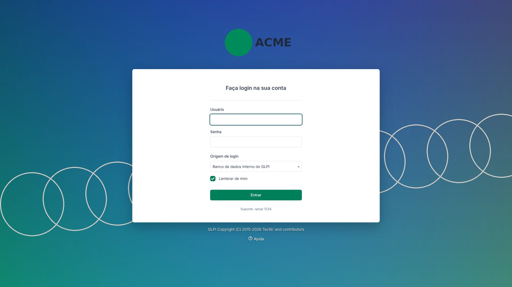

<div align="center">


# Custom Branding for GLPI 12

**Apply your organization's visual identity to GLPI: logos, favicon, login background, colors and application name. No core file is modified.**

[](https://glpi-project.org)
[](https://www.php.net)
[](LICENSE)
[](https://github.com/f4tjs/glpi-plugin-custombranding/actions/workflows/ci.yml)
[](https://github.com/f4tjs/glpi-plugin-custombranding/releases)
[](phpstan.neon.dist)
[-d97757)](#-ai-assisted-development)

[🇧🇷 Português](README.md) · 🇺🇸 English



</div>

---

## ✨ Features

- **Logos** for the login page and the side menu (expanded and collapsed).
- **Favicon** and home-screen shortcut icon.
- **Login background** for desktop (Full HD/4K) and a separate one for phones in portrait, with adjustable darkening.
- **Brand colors** (primary color, menu background and text) with a WCAG contrast check.
- **Application name** (browser tab title, e-mail footer, 2FA label) and a short **login notice**.
- **Smart validation** of real file type, size, dimensions and aspect ratio, in the browser *and* on the server.
- **Live preview** of desktop login, mobile login, menu and browser tab before saving.
- **Responsive** from 360 px phones to 4K screens; works with GLPI light and dark palettes.
- **Original quality**: images are never resized or recompressed.
- **Translations**: English and Brazilian Portuguese.
- **Reversible**: removing an image or uninstalling restores the stock GLPI look.

## 📋 Requirements

GLPI **12.0.x** · PHP **8.3+** with `fileinfo` (optional: `exif`, so rotated phone photos are validated correctly).

## 📦 Installation

> [!IMPORTANT]
> The folder **must** be named `custombranding`, with `setup.php` directly inside it: `glpi/plugins/custombranding/setup.php`.

```bash
cd /var/www/glpi/plugins
wget https://github.com/f4tjs/glpi-plugin-custombranding/releases/download/v1.0.0/custombranding-1.0.0.zip
unzip custombranding-1.0.0.zip && rm custombranding-1.0.0.zip
chown -R www-data:www-data custombranding

php bin/console plugin:install custombranding -u <admin>   # from the GLPI root
php bin/console plugin:activate custombranding
```

**Docker (official `glpi/glpi` image):** mount your plugins folder at **`/var/www/glpi/plugins`**. GLPI does not read `/var/glpi/plugins`.

```yaml
volumes:
  - /opt/glpi/config:/var/glpi/config
  - /opt/glpi/files:/var/glpi/files
  - /opt/glpi/marketplace:/var/glpi/marketplace
  - /opt/glpi/logs:/var/glpi/logs
  - /opt/glpi/plugins:/var/www/glpi/plugins
```

Then run `sudo chown -R 33:33 /opt/glpi/plugins /opt/glpi/logs` on the host (33 = `www-data` inside the container).

## 🚀 Usage

Go to **Setup → Custom Branding**, pick your images (each field shows recommended, minimum and maximum size, maximum weight and accepted formats), check the instant *Compatible / Warnings / Incompatible* diagnosis and the preview, then **Save**. Only profiles allowed to update the general setup can access it.

| Image | Recommended | Min | Max | Max size | Formats |
|---|---|---|---|---|---|
| Login logo | 400×220 | 200×110 | 2000×1100 | 1 MB | PNG, WebP, JPG |
| Menu logo (expanded) | 200×110 | 100×55 | 1000×550 | 1 MB | PNG, WebP, JPG |
| Menu logo (collapsed) | 128×128 | 40×40 | 512×512 | 512 KB | PNG, WebP, JPG |
| Favicon (square) | 192×192 | 32×32 | 512×512 | 512 KB | PNG |
| Login background (desktop) | **1920×1080** | 1280×720 | 3840×2160 | 5 MB | JPG, WebP, PNG |
| Login background (mobile) | 1080×1920 | 720×1280 | 2160×3840 | 3 MB | JPG, WebP, PNG |

## 🔒 Security

No core files modified · images stored outside the web root · closed list of route names (no path traversal) · real type detection (`finfo` + `getimagesize`) · SVG rejected · `nosniff` + CSP `sandbox` · admin-only (GLPI firewall + `Config::canUpdate()`) · CSRF enforced by GLPI 12 core · strict color/text sanitization · content-hashed URLs for caching. See [SECURITY.md](SECURITY.md).

## 🧰 Tech stack

GLPI 12 plugin API · PHP 8.3 (enums, readonly, typed constants, PSR-4) · Symfony routing (`#[Route]`, `#[SecurityStrategy]`) · Twig · Bootstrap/Tabler · vanilla JavaScript · CSS custom properties and container queries · gettext · PHPStan level 8 · GitHub Actions · tested with Playwright on a real GLPI 12.0.0.

## 🤖 AI-assisted development

Built by **[F4tjs](https://github.com/f4tjs)** with the help of AI: **Claude by [Anthropic](https://www.anthropic.com)**. The AI helped with GLPI 12 code analysis, architecture, implementation, security review, UI testing and documentation. All code was validated on a real GLPI 12.0.0 install and passes PHPStan level 8. Design decisions, final review and maintenance belong to the author.

## 🤝 Contributing · 📄 License

See [CONTRIBUTING.md](CONTRIBUTING.md). Released under **GPL-3.0-or-later**, the same license as GLPI ([LICENSE](LICENSE)). GLPI is a trademark of Teclib'; this is an independent community project.

<div align="center"><sub>Made by <a href="https://github.com/f4tjs">F4tjs</a> · with help from Claude (Anthropic)</sub></div>
