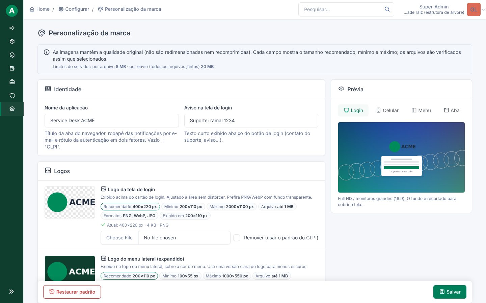
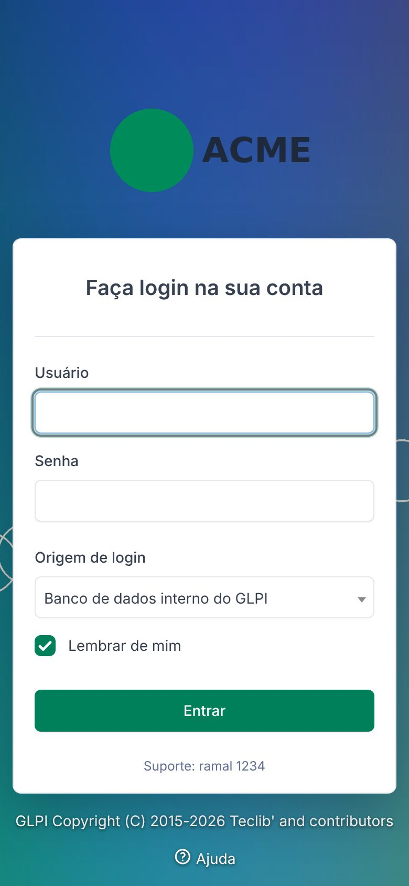
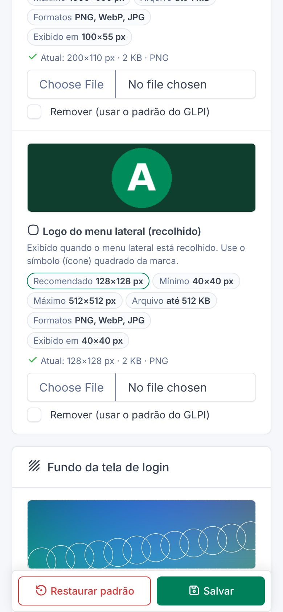
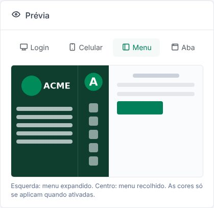
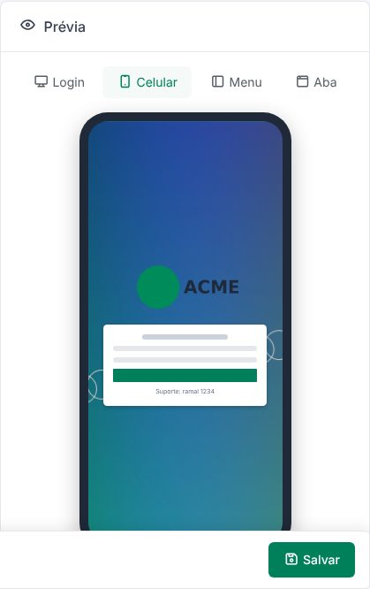

<div align="center">


# Custom Branding para GLPI 12

**Aplique a identidade visual da sua organização ao GLPI: logos, favicon, fundo do login, cores e nome da aplicação. Sem tocar em nenhum arquivo do núcleo.**

[](https://glpi-project.org)
[](https://www.php.net)
[](LICENSE)
[](https://github.com/f4tjs/glpi-plugin-custombranding/actions/workflows/ci.yml)
[](https://github.com/f4tjs/glpi-plugin-custombranding/releases)
[](phpstan.neon.dist)
[-d97757)](#-desenvolvimento-assistido-por-ia)

🇧🇷 Português · [🇺🇸 English](README.en.md)


</div>

---

## Sumário

- [Recursos](#-recursos)
- [Capturas de tela](#-capturas-de-tela)
- [Requisitos](#-requisitos)
- [Instalação](#-instalação)
- [Uso](#-uso)
- [Tamanhos de imagem](#-tamanhos-de-imagem)
- [Segurança](#-segurança)
- [Tecnologias](#-tecnologias)
- [Arquitetura](#-arquitetura)
- [Desenvolvimento](#-desenvolvimento)
- [Solução de problemas](#-solução-de-problemas)
- [Desenvolvimento assistido por IA](#-desenvolvimento-assistido-por-ia)
- [Contribuindo](#-contribuindo)
- [Licença](#-licença)

## ✨ Recursos

| | Recurso | Detalhes |
|---|---|---|
| 🖼️ | **Logos** | Tela de login, menu lateral expandido e menu recolhido |
| 🔖 | **Favicon** | Aba do navegador, favoritos e atalho na tela inicial (apple-touch-icon) |
| 🌄 | **Fundo do login** | Imagem para computador (Full HD/4K) e outra para celular em retrato, com escurecimento ajustável |
| 🎨 | **Cores da marca** | Cor principal (botões e links), fundo e texto do menu, com aviso de contraste WCAG |
| 🏷️ | **Nome da aplicação** | Título da aba, rodapé dos e-mails de notificação e rótulo do 2FA |
| 💬 | **Aviso no login** | Texto curto abaixo do botão "Entrar" (ex.: contato do suporte) |
| ✅ | **Validação inteligente** | Tipo real, peso, dimensões mínima/máxima/recomendada e proporção, verificados no navegador **e** no servidor |
| 👁️ | **Prévia ao vivo** | Login no computador, login no celular, menu e aba do navegador, antes de salvar |
| 📱 | **Responsivo** | Do celular (360 px) ao 4K; compatível com as paletas claras e escuras do GLPI |
| 💎 | **Qualidade original** | Nenhuma imagem é redimensionada ou recomprimida |
| 🌐 | **Traduções** | Português (Brasil) e inglês |
| ♻️ | **Reversível** | Remover uma imagem ou desinstalar devolve o visual original do GLPI |

## 📸 Capturas de tela

<table>
  <tr>
    <td colspan="3" align="center"><br><sub>Tela de configuração com especificações e prévia</sub></td>
  </tr>
  <tr>
    <td align="center" width="33%"><br><sub>Login no celular</sub></td>
    <td align="center" width="33%"><br><sub>Configuração no celular</sub></td>
    <td align="center" width="33%"><br><sub>Prévia do menu (expandido e recolhido)</sub><br><br><br><sub>Prévia do login no celular</sub></td>
  </tr>
</table>

## 📋 Requisitos

| Componente | Versão |
|---|---|
| GLPI | **12.0.x** |
| PHP | **8.3** ou superior |
| Extensões PHP | `fileinfo` (obrigatória, já exigida pelo GLPI) · `exif` (opcional: corrige a orientação de fotos de celular) |
| Navegadores | Chrome, Edge, Firefox e Safari atuais (desktop e mobile) |

## 📦 Instalação

> [!IMPORTANT]
> A pasta do plugin **precisa** se chamar `custombranding`, e o arquivo `setup.php` deve ficar diretamente dentro dela: `glpi/plugins/custombranding/setup.php`.

### Opção 1: pacote de release (recomendado)

```bash
cd /var/www/glpi/plugins
wget https://github.com/f4tjs/glpi-plugin-custombranding/releases/download/v1.0.0/custombranding-1.0.0.zip
unzip custombranding-1.0.0.zip && rm custombranding-1.0.0.zip
chown -R www-data:www-data custombranding
```

### Opção 2: Git

```bash
cd /var/www/glpi/plugins
git clone https://github.com/f4tjs/glpi-plugin-custombranding.git custombranding
```

### Opção 3: Docker (imagem oficial `glpi/glpi`)

Na imagem oficial o código do GLPI fica em `/var/www/glpi`, e o volume de dados em `/var/glpi`. Monte a pasta de plugins em **`/var/www/glpi/plugins`** (e não em `/var/glpi/plugins`, que o GLPI não lê):

```yaml
services:
  glpi:
    image: glpi/glpi:12.0.0
    volumes:
      - /opt/glpi/config:/var/glpi/config
      - /opt/glpi/files:/var/glpi/files
      - /opt/glpi/marketplace:/var/glpi/marketplace
      - /opt/glpi/logs:/var/glpi/logs
      - /opt/glpi/plugins:/var/www/glpi/plugins     # ← plugins próprios
```

```bash
# no host Docker
sudo mkdir -p /opt/glpi/plugins /opt/glpi/logs
cd /opt/glpi/plugins && sudo unzip /caminho/custombranding-1.0.0.zip
sudo chown -R 33:33 /opt/glpi/plugins /opt/glpi/logs   # 33 = www-data no container
```

### Ativação

Pela interface: **Configurar → Plug-ins → Custom Branding → Instalar → Ativar** (o GLPI 12 pode pedir sua senha novamente nessa tela).

Ou pela linha de comando (`docker exec -it glpi …` no Docker):

```bash
php bin/console plugin:install custombranding -u <admin>
php bin/console plugin:activate custombranding
php bin/console cache:clear
```

### Atualização

Substitua a pasta `custombranding` pela versão nova e rode `php bin/console cache:clear`. As configurações e imagens são preservadas.

## 🚀 Uso

1. Acesse **Configurar → Personalização da marca** (ou clique no nome do plugin em *Configurar → Plug-ins*).
2. Escolha as imagens: cada campo mostra o tamanho **recomendado, mínimo e máximo**, o peso máximo e os formatos aceitos.
3. Confira o diagnóstico exibido na hora: **Compatível**, **Compatível, com avisos** ou **Incompatível**, com o motivo.
4. Veja o resultado nas abas da **Prévia** (Login, Celular, Menu, Aba).
5. Preencha o nome da aplicação, o aviso do login e, se quiser, ative as cores da marca.
6. Clique em **Salvar**.

Para desfazer: marque **Remover (usar o padrão do GLPI)** numa imagem ou use **Restaurar padrão** para limpar tudo.

> [!NOTE]
> Somente perfis com direito de **alterar a Configuração geral** veem e acessam a tela.

## 📐 Tamanhos de imagem

Os tamanhos recomendados são o dobro do tamanho exibido, para nitidez em telas de alta densidade (Retina, notebooks com escala 150–200%, monitores 4K).

| Imagem | Recomendado | Mínimo | Máximo | Peso máx. | Formatos | Proporção |
|---|---|---|---|---|---|---|
| Logo do login | 400×220 | 200×110 | 2000×1100 | 1 MB | PNG, WebP, JPG | livre (ajusta sem distorcer) |
| Logo do menu (expandido) | 200×110 | 100×55 | 1000×550 | 1 MB | PNG, WebP, JPG | livre |
| Logo do menu (recolhido) | 128×128 | 40×40 | 512×512 | 512 KB | PNG, WebP, JPG | quadrada (recomendado) |
| Favicon | 192×192 | 32×32 | 512×512 | 512 KB | PNG | **quadrada (obrigatório)** |
| Fundo do login (computador) | **1920×1080** | 1280×720 | 3840×2160 | 5 MB | JPG, WebP, PNG | paisagem, ideal 16:9 |
| Fundo do login (celular) | 1080×1920 | 720×1280 | 2160×3840 | 3 MB | JPG, WebP, PNG | retrato, ideal 9:16 |

- **Erro** (não salva): formato inválido, arquivo corrompido, peso acima do limite, dimensões fora do mínimo/máximo, favicon não quadrado.
- **Aviso** (salva e informa): abaixo do recomendado, proporção diferente da ideal (as bordas serão recortadas).
- O peso máximo exibido já considera os limites do PHP (`upload_max_filesize` e `post_max_size`).

> [!TIP]
> Para logos, use PNG ou WebP com fundo transparente. Para fotos de fundo, use JPG (qualidade 80–90) ou WebP e mantenha o assunto principal no centro: o recorte preserva o centro da imagem.

## 🔒 Segurança

| Medida | Implementação |
|---|---|
| Núcleo intacto | Logos e cores aplicados sobrescrevendo variáveis CSS do próprio GLPI |
| Arquivos protegidos | Imagens em `files/_plugins/custombranding/`, fora da raiz web |
| Sem *path traversal* | A rota de imagens aceita apenas nomes de uma lista fechada; o nome em disco é revalidado |
| Tipo real verificado | `finfo` + `getimagesize`; a extensão e o MIME enviados pelo navegador são ignorados |
| SVG bloqueado | Apenas PNG, JPG e WebP (SVG pode conter JavaScript) |
| Sem "bomba de pixels" | Apenas o cabeçalho da imagem é lido; limites de dimensão e peso |
| Entrega segura | `Content-Type` fixo, `X-Content-Type-Options: nosniff`, CSP `sandbox` |
| Controle de acesso | Firewall `ADMIN_ACCESS` do GLPI + `Config::canUpdate()` |
| CSRF | Validado pelo núcleo do GLPI 12 (`Sec-Fetch-Site`/`Origin`) |
| Sem injeção | Cores somente `#rrggbb`; textos sem HTML, com limite de tamanho e sempre escapados |
| Cache correto | URLs versionadas por hash: cache de 1 ano e atualização imediata ao trocar |

Encontrou uma vulnerabilidade? Veja a [política de segurança](SECURITY.md).

## 🧰 Tecnologias

| Camada | Tecnologia |
|---|---|
| Plataforma | [GLPI 12](https://glpi-project.org) (API de plugins, hooks, firewall, `glpi_configs`) |
| Back-end | PHP 8.3 (enums, `readonly`, constantes tipadas), PSR-4 |
| Rotas | Symfony Routing via controllers de plugin com atributos `#[Route]` e `#[SecurityStrategy]` |
| Interface | Twig, Bootstrap / [Tabler](https://tabler.io) e Tabler Icons (já incluídos no GLPI) |
| Front-end | JavaScript puro (ES2020, sem dependências) e CSS com variáveis e *container queries* |
| Imagens | `finfo`, `getimagesize`, EXIF; validação espelhada no navegador (*magic bytes* + decodificação) |
| i18n | gettext (`.po`/`.mo`) |
| Qualidade | PHPStan nível 8, GitHub Actions (lint, análise estática, release automática) |
| Testes manuais | GLPI 12.0.0 real, Playwright (Full HD, 4K, tablet, celular), testes de segurança |

## 🏗️ Arquitetura

```
custombranding/
├── setup.php                    # versão, requisitos, boot e init (registro de hooks)
├── hook.php                     # instalação / desinstalação
├── plugin.xml                   # metadados para o catálogo de plugins do GLPI
├── src/                         # GlpiPlugin\Custombranding\ (PSR-4)
│   ├── Image/
│   │   ├── ImageSlot.php        # ★ catálogo das imagens e suas regras (fonte única)
│   │   ├── ImageSpec.php        # dimensões, peso, formatos e proporção de um slot
│   │   ├── ImageValidator.php   # validação definitiva no servidor
│   │   ├── ImageStorage.php     # gravação atômica fora da raiz web
│   │   └── …                    # StoredImage, ImageFormat, AspectRule, UploadLimits, Formatter
│   ├── Config/                  # BrandingConfig (persistência) e Color (cores/contraste)
│   ├── Theme/                   # ThemeCssBuilder (CSS gerado) e HookRegistrar (hooks)
│   ├── Controller/              # ConfigController (tela) e AssetController (CSS e imagens)
│   ├── View/ConfigViewModel.php # dados para o Twig e o JavaScript
│   ├── Menu.php                 # entrada no menu Configurar
│   └── Urls.php
├── templates/config.html.twig
├── public/                      # css/config.css, js/config.js, js/favicon.js
├── locales/                     # .pot, pt_BR.po/.mo
└── tools/                       # extract_locales.py, build_release.sh
```

**Como funciona:** o `HookRegistrar` registra `theme.css?rev=<hash>` nas páginas logadas e anônimas. O `AssetController` gera esse CSS com o `ThemeCssBuilder`, que redefine as variáveis `--glpi-logo-*`, `--tblr-primary*` e `--glpi-mainmenu-*` do GLPI. As imagens são servidas por `/plugins/custombranding/asset/{slot}`.

## 🛠️ Desenvolvimento

```bash
# análise estática (com o plugin dentro de um GLPI 12)
phpstan analyse

# extrair strings, atualizar e compilar a tradução pt_BR
composer locales

# gerar o ZIP de release em dist/
sh tools/build_release.sh
```

- **Mudar um limite de imagem:** edite `ImageSlot::spec()`. O servidor, o navegador, os textos e a prévia passam a usar o novo valor.
- **Adicionar uma imagem:** novo `case` em `ImageSlot`, inclusão em `ConfigViewModel::groups()` e aplicação no `ThemeCssBuilder`.
- **Publicar versão:** atualize `setup.php`, `plugin.xml` e `CHANGELOG.md`, crie a tag `vX.Y.Z` e o GitHub Actions publica o ZIP.

## 🩺 Solução de problemas

| Sintoma | Causa provável / solução |
|---|---|
| Plugin não aparece na lista | Pasta com nome errado ou duplicada (`plugins/custombranding/custombranding`); no Docker, volume montado em `/var/glpi/plugins` em vez de `/var/www/glpi/plugins` |
| `Directory /var/glpi/logs is not writable` (Docker) | `sudo chown -R 33:33` na pasta do host; em SELinux, acrescente `:Z` ao volume |
| "Não foi possível gravar o arquivo no servidor" | Permissão de escrita em `files/_plugins/` para o usuário do servidor web |
| "Excedem o limite do servidor" | Aumente `post_max_size`/`upload_max_filesize` ou envie menos imagens por vez |
| Tela sem estilo após atualizar | `php bin/console cache:clear` |
| Aviso `Unable to load plugin "customlogin"` | Plugin antigo registrado sem arquivos: use **Limpar** em *Configurar → Plug-ins* |
| Menu com as cores da paleta do usuário | Ative "Aplicar cores da marca" |

**Limitações conhecidas:** uma pequena imagem do logo do GLPI no menu suspenso do usuário é fixa no template do núcleo; o texto de copyright do GLPI no rodapé do login não é alterado.

## 🤖 Desenvolvimento assistido por IA

Este projeto foi desenvolvido por **[F4tjs](https://github.com/f4tjs)** com o auxílio de inteligência artificial: **Claude, da [Anthropic](https://www.anthropic.com)**.

A IA apoiou a análise do código do GLPI 12, a arquitetura, a implementação, a revisão de segurança, os testes de interface e a documentação. Todo o código foi validado em uma instalação real do GLPI 12.0.0 e passa pela análise estática do PHPStan (nível 8). As decisões de projeto, a revisão final e a manutenção são do autor.

## 🤝 Contribuindo

Contribuições são bem-vindas! Leia o [CONTRIBUTING.md](CONTRIBUTING.md), abra uma [issue](https://github.com/f4tjs/glpi-plugin-custombranding/issues) ou envie um *pull request*.

## 📄 Licença

Distribuído sob a licença **GPL-3.0-or-later**, a mesma do GLPI. Veja [LICENSE](LICENSE).

GLPI é uma marca da [Teclib'](https://www.teclib.com). Este é um projeto independente da comunidade, sem afiliação oficial.

---

<div align="center">
Feito por <a href="https://github.com/f4tjs">F4tjs</a> · com a ajuda de Claude (Anthropic)
<br>
Se este plugin foi útil, deixe uma ⭐ no repositório.
</div>
